<div align="center">

 &nbsp;&nbsp;  &nbsp;&nbsp; 

# ⚽ Football Analytics Platform

**World Cup · Euro · Copa América · Nations League** — a full data-engineering, data-science and analytics platform for men's international tournament football, with a broadcast-style React dashboard.

[](https://football-analytics-xi.vercel.app)


[**Live demo**](https://football-analytics-xi.vercel.app) · [Screenshots](#-screenshots) · [Architecture](#-architecture) · [Quick start](#-quick-start) · [Docs](#-documentation)

<sub>The demo's API runs from the author's PC through a free tunnel, so it can be offline. See [Deployment](docs/DEPLOYMENT.md).</sub>

</div>

---

## ✨ What it is

A medallion pipeline (**Bronze → Silver → PostgreSQL star schema → dbt Gold**) that unifies six open data sources, a statistics and machine-learning layer, and a **React + FastAPI** dashboard with a visual identity per tournament: every edition page is built from that edition's own logo, colours and artwork.

- **1,830 matches** (1,779 played + 51 *Coming soon*), **103 national teams**, **8,410 canonical players**, **4,494 goals**, **1,033,220 event rows**
- **30 editions**: World Cup 2002–2026 (+ **2030 coming soon**), Euro 2000–2028, Copa América 2001–2028, Nations League 2018–2027
- **85 interactive charts** (Plotly) with a table view and CSV / HTML / PNG export for each
- **Broadcast-style Match Center**: scoreboard, scorers and assists, managers, statistics, line-ups on a pitch, event timeline, head-to-head
- **Honest by design**: nothing is invented, missing data stays empty, upcoming fixtures say **Coming soon**, model output is always labelled as a prediction

## 📸 Screenshots

<table>
<tr>
<td width="50%">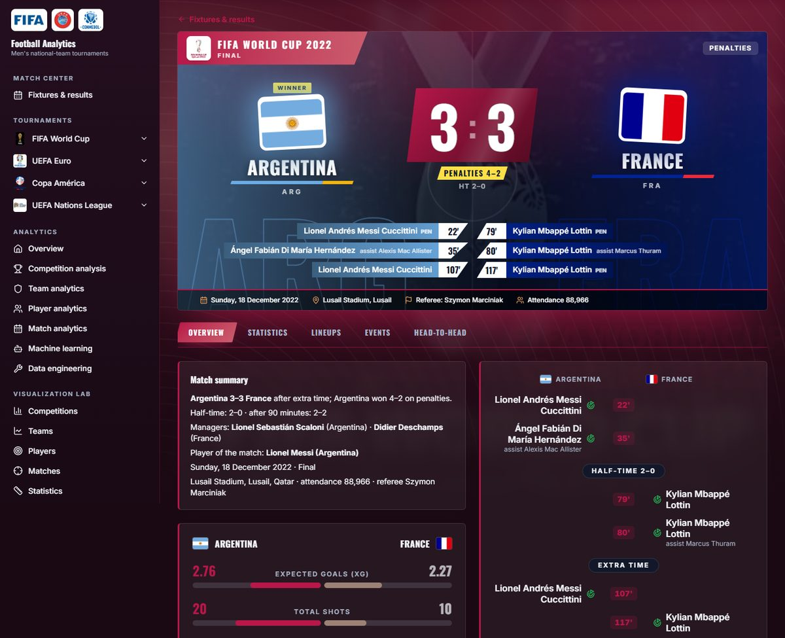<br><sub><b>Match Center</b>: broadcast scoreboard with national colours, scorers + assists, managers, statistics</sub></td>
<td width="50%">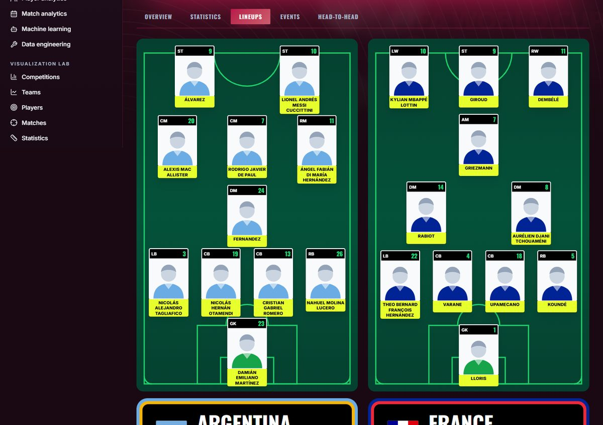<br><sub><b>Line-ups</b>: formation derived from recorded positions, manager and substitutes</sub></td>
</tr>
<tr>
<td>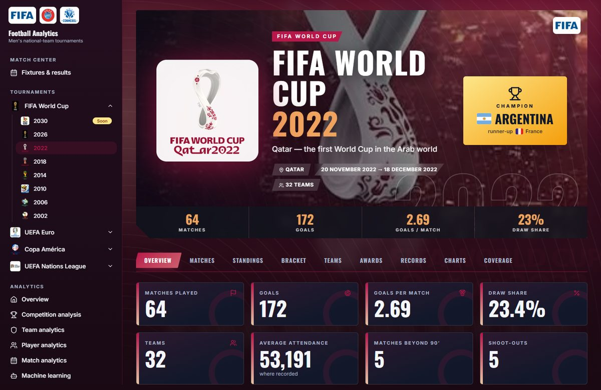<br><sub><b>One design per edition</b>: World Cup 2022, themed from its logo</sub></td>
<td>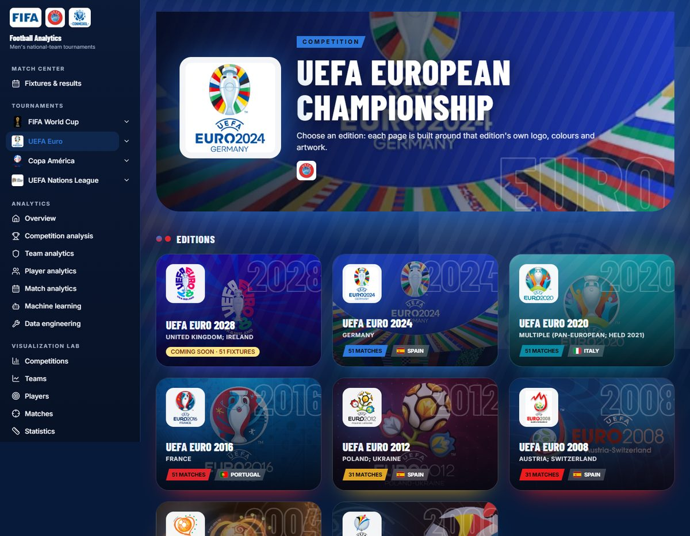<br><sub><b>Competition hub</b>: every edition with its own artwork</sub></td>
</tr>
<tr>
<td>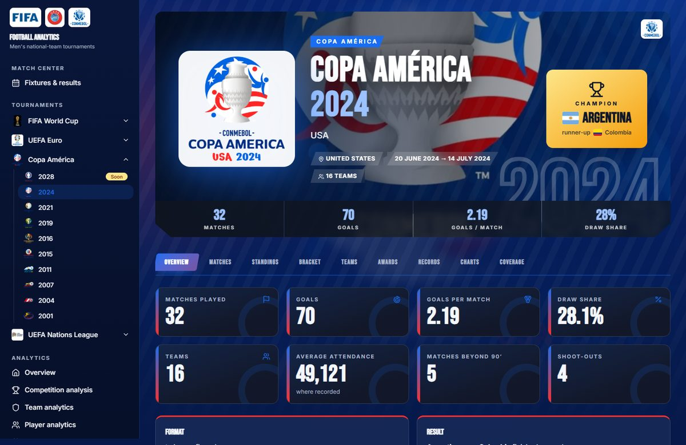<br><sub><b>Copa América 2024</b>: a different typographic and shape language per competition</sub></td>
<td>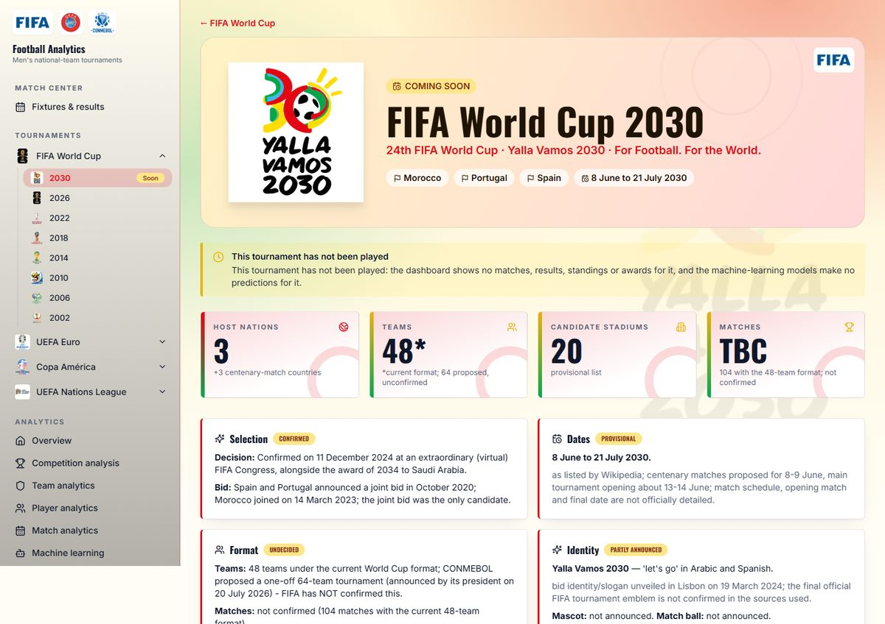<br><sub><b>World Cup 2030</b>: coming soon, every confirmed/provisional/undecided detail sourced</sub></td>
</tr>
<tr>
<td>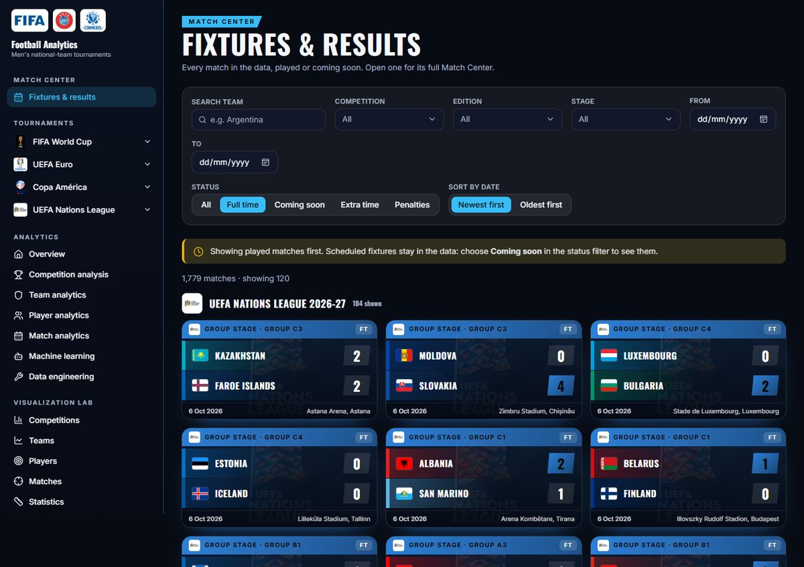<br><sub><b>Fixtures & results</b>: filters, search, played and coming-soon matches</sub></td>
<td>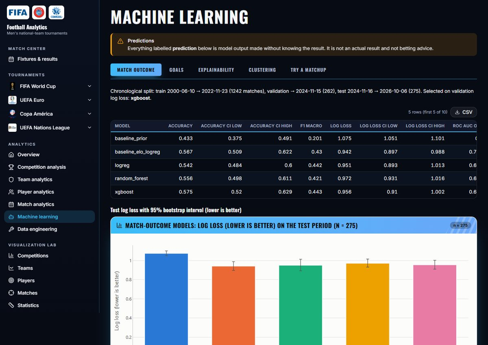<br><sub><b>Machine learning</b>: test metrics with bootstrap intervals, confusion matrices, predictor</sub></td>
</tr>
</table>

<details><summary><b>Visualization lab</b> (85 charts, shared filters, click-to-filter)</summary><br>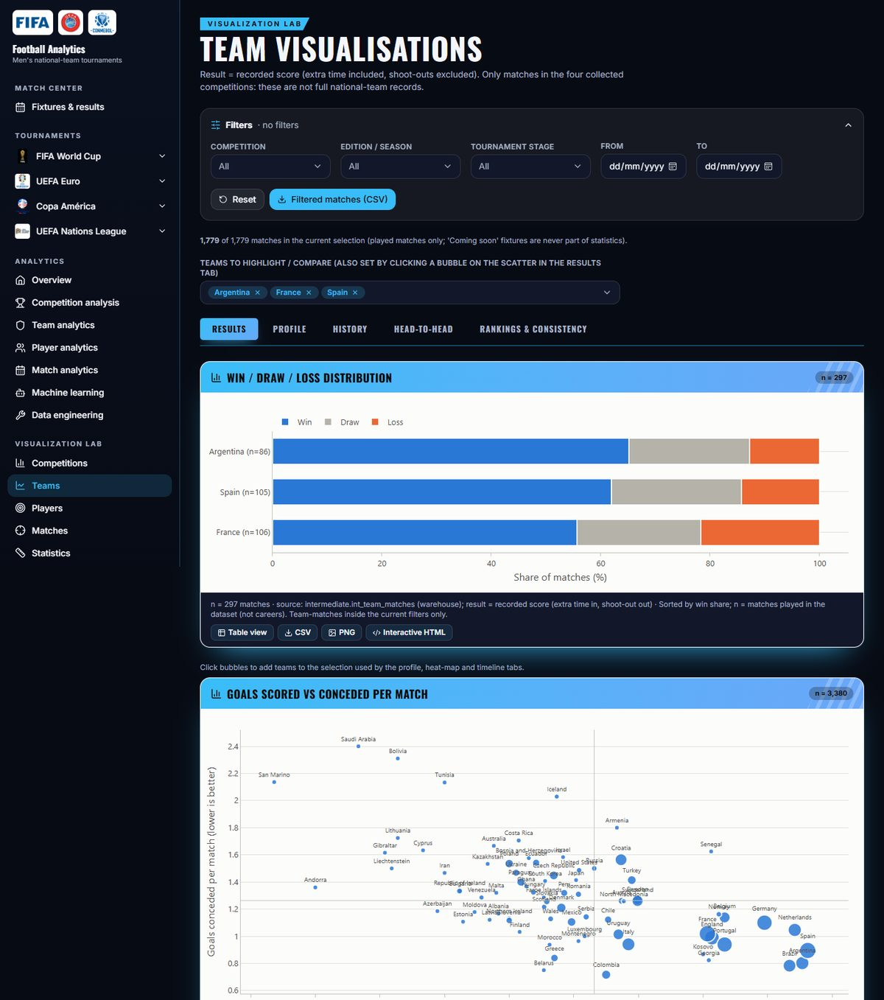</details>
<details><summary><b>Home</b></summary><br>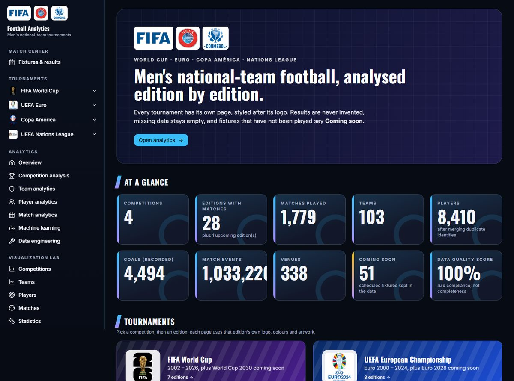</details>

## 🏗 Architecture

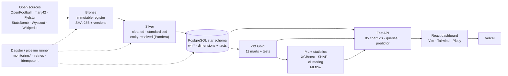

**Design choice:** Python builds every Plotly figure server-side and returns it as JSON, and React renders it. The same code that powers the analysis powers the UI, so there is one source of truth and every "not shown: reason" rule is preserved.

## 🧰 Tech stack

| Layer | Technology |
|---|---|
| Ingestion | Python, requests, MediaWiki API, mwparserfromhell, BeautifulSoup |
| Processing | pandas, PyArrow / Parquet, Pandera validation, entity resolution |
| Warehouse | PostgreSQL (Docker), star schema, surrogate keys, constraints |
| Transformation | dbt-core / dbt-postgres (115 models + tests) |
| Orchestration & monitoring | Dagster, `monitoring.*` tables (runs, DQ results, freshness, coverage) |
| Statistics & ML | scipy, statsmodels, scikit-learn, XGBoost, SHAP, MLflow |
| API | FastAPI, Uvicorn, psycopg 3 |
| Front end | React 18, TypeScript, Vite, Tailwind, TanStack Query, framer-motion, Plotly.js, flag-icons |
| Deployment | Vercel (front end), Cloudflare tunnel (API), Neon (hosted Postgres), Docker |
| Quality | pytest (223), vitest (6), dbt tests, Pandera, PostgreSQL constraints |

## 🎨 Dashboard

- **Tournaments**: a themed page for every edition (overview, matches, standings, bracket, teams, awards, records, charts, coverage); competition hubs; **World Cup 2030** inside the World Cup section
- **Match Center & Fixtures**: broadcast scoreboards, team colours, flags for every nation, status badges, timeline, line-ups on a pitch
- **Analytics** (7 pages): overview, competition, teams, players, matches, machine learning, data engineering
- **Visualization lab** (7 pages): competitions, teams, players, matches, statistics, ML, data engineering, with shared filters and cross-filtering

## 📚 Data sources & licences

| Source | Used for | Licence |
|---|---|---|
| [OpenFootball](https://github.com/openfootball) | fixtures, results, goal scorers | CC0 |
| [martj42/international_results](https://github.com/martj42/international_results) | results, goal scorers, assists | CC0 |
| [Fjelstul World Cup Database](https://github.com/jfjelstul/worldcup) | World Cup matches, goals, squads | CC BY-SA 4.0 |
| [StatsBomb Open Data](https://github.com/statsbomb/open-data) | events, line-ups, managers, shots | StatsBomb attribution terms |
| Wyscout public dataset | events | CC BY 4.0 |
| Wikipedia (MediaWiki API) | match boxes, awards, managers, venues, 2030 facts | CC BY-SA 4.0 |

FIFA, UEFA and CONMEBOL websites are **not** scraped (their terms prohibit it). The Champions League is out of scope by design. Logos are shown for identification of the competitions.

## 📊 Honest results

On a chronological test period (275 matches), the match-outcome models land around **55–57 % accuracy**; XGBoost does **not** clearly beat a one-feature Elo baseline (log loss 0.956 vs 0.942, intervals overlap). Goal totals barely beat the base rate, and team clusters are weak. The project reports this plainly rather than overselling the models.

## 🚀 Quick start

```bash
# 1. environment
python -m venv .venv && . .venv/Scripts/activate        # Windows; use bin/activate on macOS/Linux
pip install -r requirements.txt && pip install -e .

# 2. warehouse (PostgreSQL in Docker, host port 5442)
docker compose up -d
python -m fbplatform.orchestration.steps                # Bronze → Silver → warehouse → dbt → coverage

# 3. API + React dashboard
set PYTHONPATH=src
python -m uvicorn fbplatform.api.main:app --port 8000
cd frontend && npm install && npm run dev               # http://localhost:5173 (proxies /api to :8000)
#    or: npm run build  → the API then serves the built app at http://localhost:8000

# optional: the original Streamlit dashboard
streamlit run src/fbplatform/dashboard/app.py
```

Tests: `python -m pytest -q` (full suite takes ~20 min: statistics permutations, model training, dbt) · `cd frontend && npm test`.

## 🌐 Deployment

Front end on **Vercel**, warehouse copy on **Neon**, API through a free Cloudflare tunnel (`python tools/serve_public.py`). Details and the always-on options (Docker image, `render.yaml`) are in [`docs/DEPLOYMENT.md`](docs/DEPLOYMENT.md).

## 🗂 Project structure

```text
src/fbplatform/
  ingest/ medallion/ validation/    Bronze · Silver · Pandera
  warehouse/ monitoring/ orchestration/   star schema loader · run/DQ/freshness logging · Dagster
  analysis/ ml/                     EDA, statistics, features, models, clustering, advanced projects
  viz/                              chart library (Plotly + Matplotlib/Seaborn twins, exports)
  api/                              FastAPI: chart registry, queries, tournaments, match center, fixtures
  dashboard/                        original Streamlit app
frontend/                           React + TypeScript dashboard (themes per edition)
dbt/  sql/                          Gold marts + tests · warehouse DDL
tests/  notebooks/  docs/  reports/ tools/  deploy/
```

## 📖 Documentation

[Architecture](docs/ARCHITECTURE.md) · [Pipeline guide](docs/PIPELINE_GUIDE.md) · [Data sources](docs/DATA_SOURCES.md) · [Database schema](docs/DATABASE_SCHEMA.md) · [Data dictionary](docs/DATA_DICTIONARY.md) · [Data quality](docs/DATA_QUALITY.md) · [Statistical report](docs/STATISTICAL_REPORT.md) · [Model documentation](docs/MODEL_DOCUMENTATION.md) · [Data-science report](docs/DATA_SCIENCE_REPORT.md) · [React dashboard guide](docs/REACT_DASHBOARD_GUIDE.md) · [Visualization guide](docs/VISUALIZATION_GUIDE.md) · [Deployment](docs/DEPLOYMENT.md)

## ⚠️ Known limits

Nations League has no manager or assist data and its scorers are not linked to player ids; assists exist only for some editions; 7 matches lack some scorers in every source; the live demo depends on the author's PC being on.

---

<div align="center"><sub>Built by <a href="https://github.com/alirazach476">Ali Raza</a> · data from open sources, see licences above</sub></div>
